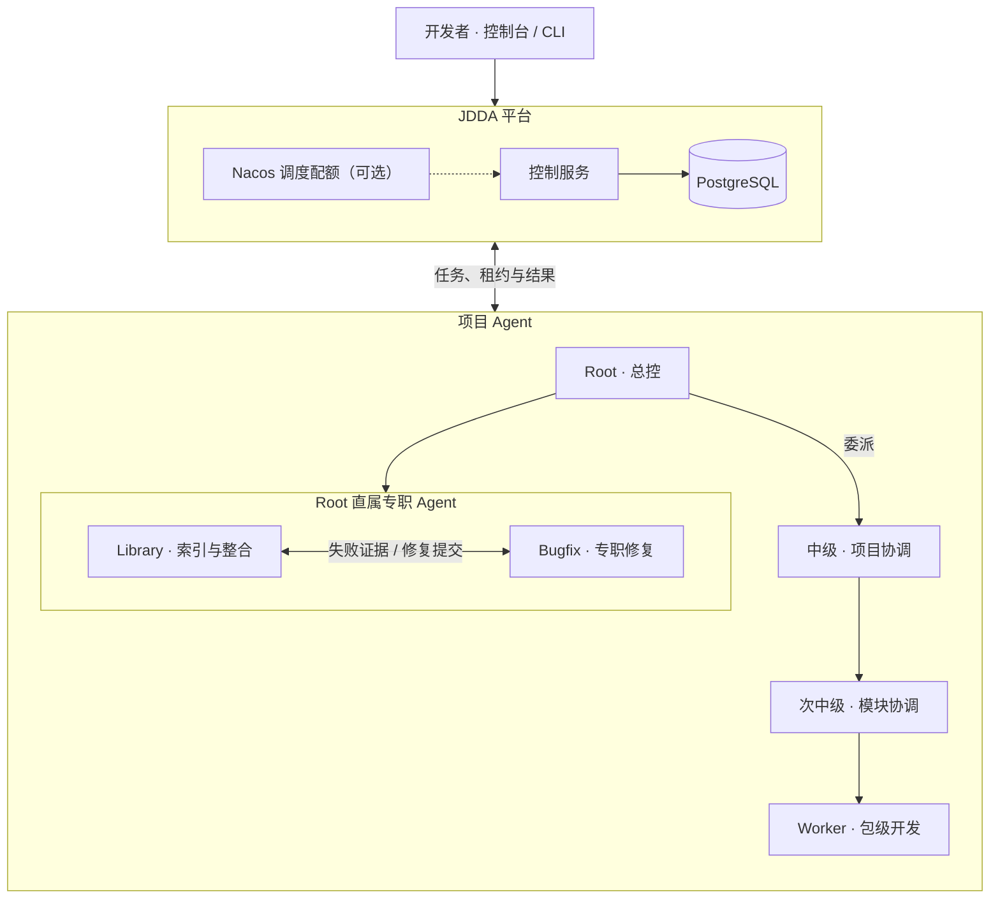
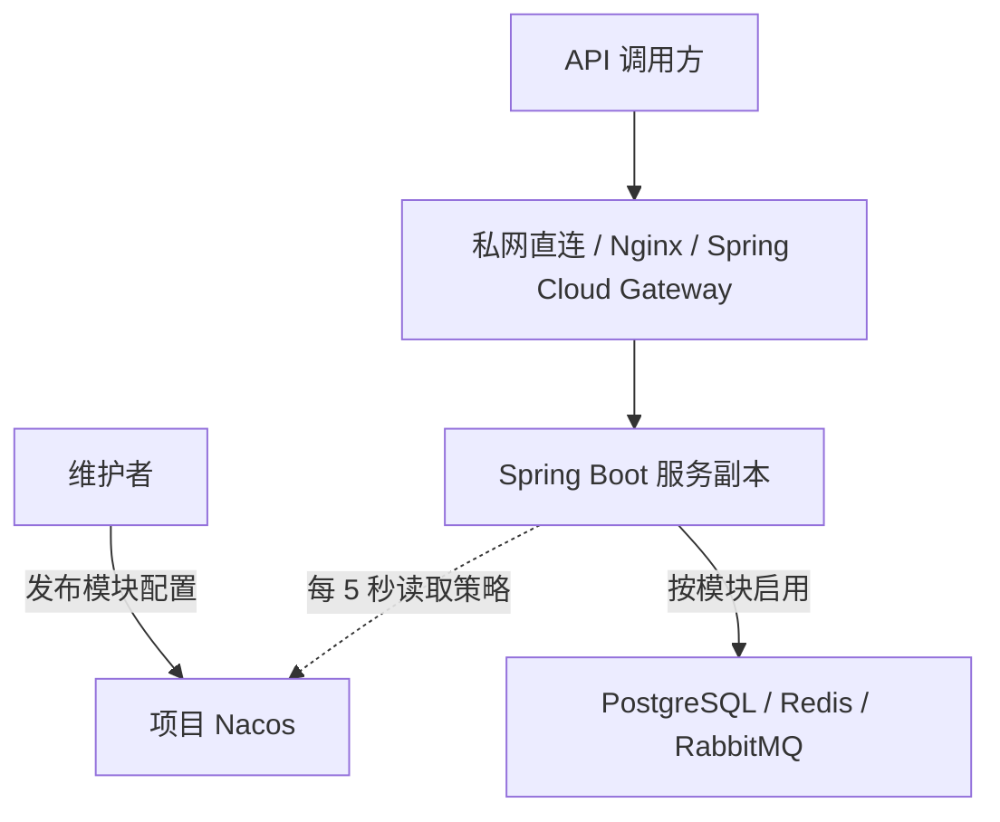
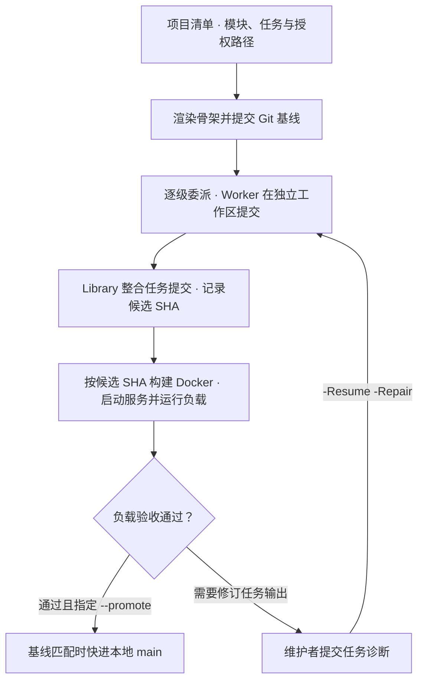

# JDDA · Java 多智能体开发平台

JDDA 面向熟悉 Java、Git 和 Docker 的开发者。你定义服务边界、技术栈、包级任务和验收标准。Agent 按范围生成代码，Library 整合候选，验收器在 Docker 中验证候选的完整 Git SHA。

## 架构

### JDDA 控制服务与 Agent 分工



控制服务校验委派关系、任务范围与领取资格，保存租约、结果和操作事件。Root 可以从 Library 按需查询任务摘要及其证据。Root 授权专职修复时，Bugfix 从独立队列领取任务，依据 Library 中的失败证据工作。规划与执行角色可配置各自的模型接口，数据库、配置和部署任务可按资源边界划分。[Agent 架构](contracts/AGENT_ARCHITECTURE.md) · [模型与部署配置](docs/PLATFORM_SETUP.md)

控制台可切换项目、暂停派发、查看阶段轨迹和工具结果，并在授权范围内追加指令。Worker 在检查点采用新指令，结果携带对应版本。各执行主机可用独立身份连接同一控制服务。[控制台与跨主机运行](docs/RELEASE_RUNBOOK.md)

### 生成项目的服务拓扑



项目清单指定模块、入口和副本数。每个服务副本从项目 Nacos 读取所属模块的策略，在实例内应用业务参数和在途请求上限。模块可选 Sentinel 做限流熔断，或用 OpenFeign 调用其他服务。[生成项目维护手册](docs/PROJECT_GENERATION.md)

## 从项目清单到交付



生成脚本把基线、Worker 提交和候选 SHA 写入 `generation.json`。验收器核对候选的提交图及文件范围，使用隔离的 Compose 环境运行负载并保存报告。需要发布远端候选时，再执行仓库 CI 和审批。[生成脚本](scripts/Invoke-ProjectGeneration.ps1) · [验收记录](docs/PROJECT_ACCEPTANCE.md) · [远端发布流程](docs/RELEASE_RUNBOOK.md#发布已审查候选)

## 运行平台

准备 PowerShell 7、JDK 21、Maven、Git、Python 3.12 和 PostgreSQL。需要生成项目的容器验收时，启动支持 Linux 容器的 Docker Compose。控制服务用独立 PostgreSQL 库，首次部署前按下文创建应用角色。

```powershell
./scripts/Deploy-Platform.ps1 -OpenConsole
./scripts/Set-PlatformModel.ps1
./scripts/Test-PlatformModel.ps1
```

部署默认使用本机 `127.0.0.1:18080`。数据库密码、管理员令牌和模型 API Key 由 Windows 当前用户加密存储。默认模型是 DeepSeek。其他 OpenAI 兼容的 Chat Completions 服务可用 `-BaseUrl` 和 `-Model` 指定，Root、中级、次中级、Worker 和 Bugfix 也可各自指定模型与凭据。[部署、地址与模型配置](docs/PLATFORM_SETUP.md)

## 生成和验收一个项目

先查看 [项目清单](examples/projects/reservations.json)。示例中的容量预留只是用来验证并发、幂等和故障恢复，服务、包、路由和验收用例都可以换成自己的设计。

```powershell
$manifest = 'examples/projects/reservations.json'
$project = 'target/generated-projects/reservations-demo'
./scripts/Invoke-ProjectGeneration.ps1 -Manifest $manifest -Output $project
python -B scripts/Verify-GeneratedProject.py --manifest $manifest --generation "$project.jdda/generation.json" --suite reservations --promote
```

生成目录应为新路径。加 `-Minimal` 可保留所选 PostgreSQL、Git、Docker 和 Nacos，省去可选缓存、消息队列、限流熔断和代理。失败后用相同清单、输出目录和预设加 `-Resume` 继续。已整合候选出现编译或行为错误时，可将诊断按任务 ID 提供给 `-Resume -Repair`，让相应 Agent 重新生成受影响的提交。

验收器先核对任务提交和可信基线，再构建精确候选、运行独立容器并保存报告。`--promote` 仅在负载验收通过且本地分支仍位于原基线时快进。自定义项目用 `--workload` 指定仓库外的验收脚本。[清单、部署、配置发布和自定义验收](docs/PROJECT_GENERATION.md)

## 配置分层

| 配置面 | 维护方式 |
| --- | --- |
| 模块、包、实例数和入口 | 在项目清单中定义。入口可选 Docker 私网直连、Nginx 或 Spring Cloud Gateway。 |
| 服务运行策略 | Nacos 按项目 Group、服务 Data ID 发布。每个实例可热调在途请求上限和业务参数。选用 Redis 或 Sentinel 的模块还可调缓存 TTL、请求 QPS 和熔断窗口。 |
| 业务依赖 | 按模块选 PostgreSQL、Redis、RabbitMQ、Sentinel 和 OpenFeign。RabbitMQ 预设配套 PostgreSQL 事务发件箱。 |
| 构建与交付 | Worker 独立提交，Library 记录有序合并和完整候选 SHA。容器基础镜像固定摘要，同一服务各副本使用同一镜像。 |
| 凭据与连接 | 从部署环境注入数据库、Nacos 和服务凭据。使用 `ProjectNacos.py` 初始化只读服务账号、读取和发布配置。 |

生成骨架提供缓存、事件、限流和下游调用接口，可选适配器随模块配置启用。控制服务可从 Nacos 读取各项目的 Worker 配额。[控制服务运行治理](docs/PLATFORM_GOVERNANCE.md)

## 测试与运行范围

- `mvn -B -ntp verify` 运行平台 Java 测试。设置 `JDDA_TEST_DB_URL` 后启用 PostgreSQL 集成测试。
- 安装 `contracts/requirements.txt` 后运行 `python -B -m unittest discover -s contracts -p "test_*.py" -v`，验证执行契约和生成清单。
- [生成项目验收记录](docs/PROJECT_ACCEPTANCE.md) 包含实际候选、负载、动态配置和故障演练结果。Compose 预设用于单主机多副本部署。正式项目的多主机发布、鉴权和容量目标由项目团队定义并写入独立验收。

## 新环境数据库

用 PostgreSQL 管理账号在 psql 中创建控制服务库和独立测试库。Windows 部署脚本首次启动时会提示输入应用角色的密码。

```sql
CREATE ROLE jdda_local LOGIN NOSUPERUSER NOCREATEDB NOCREATEROLE;
\password jdda_local
CREATE DATABASE jdda_local OWNER jdda_local;
REVOKE CONNECT ON DATABASE jdda_local FROM PUBLIC;
CREATE DATABASE jdda_test OWNER jdda_local;
REVOKE CONNECT ON DATABASE jdda_test FROM PUBLIC;
```

开放源组件包括 [Spring AI Alibaba](https://github.com/alibaba/spring-ai-alibaba)、[Spring Boot](https://spring.io/projects/spring-boot)、[Nacos](https://nacos.io/)、[PostgreSQL](https://www.postgresql.org/)、[Flyway](https://github.com/flyway/flyway)，以及生成预设选择的 [Sentinel](https://sentinelguard.io/)、[Redis](https://redis.io/)、[RabbitMQ](https://www.rabbitmq.com/)、[Nginx](https://nginx.org/)、[Spring Cloud Gateway](https://spring.io/projects/spring-cloud-gateway) 和 [OpenFeign](https://spring.io/projects/spring-cloud-openfeign)。
