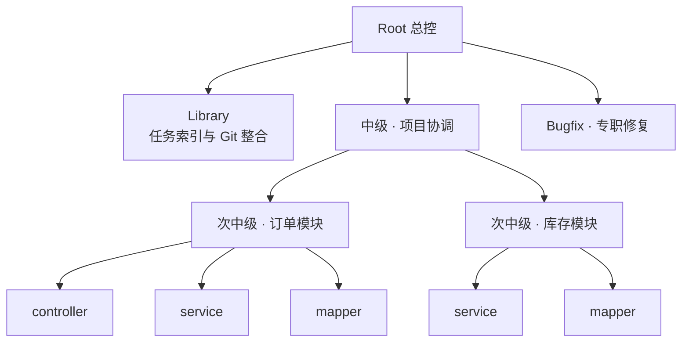
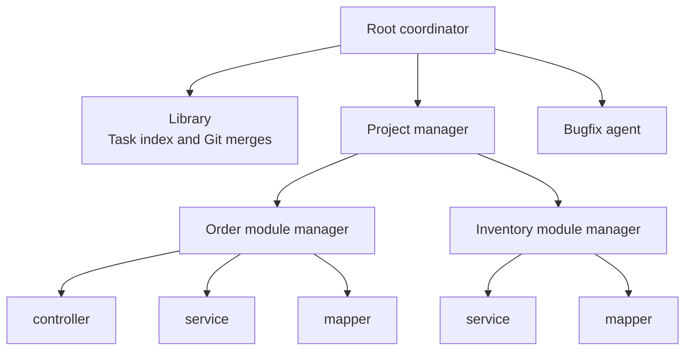

# JDDA

[中文](#中文) · [English](#english)

## 中文

JDDA 是 Java 多智能体协同开发平台，按模块和包分派开发任务。控制台通过控制服务查看任务状态，任务与租约保存在 PostgreSQL。生成的服务用 Nacos 管理运行策略。

### 架构



订单和库存是示例模块。模块下每个包由独立的 Worker 从同一 Git 基线开发并提交。Bugfix 从 Library 读取失败证据，修复后将提交交回 Library。Library 整合候选后，验收器按候选 SHA 构建 Docker 镜像并运行负载。[Agent 架构](contracts/AGENT_ARCHITECTURE.md)

### 启动

在 Windows 上准备 PowerShell 7 和 JDK 21，从源码构建时使用 Maven。将 `skills/jdda-root` 复制到 Codex 的 `~/.codex/skills/` 目录，再在项目目录调用 `$jdda-root`。也可直接运行 `./scripts/Start-JddaRoot.ps1`。

入口启动或复用控制服务，建立项目 Root 身份并打开已配对的控制台。首次配置模型时，在本机终端输入 API Key。验证通过后会加密保存。首次自动初始化数据库使用 Docker 的 Linux 容器引擎。[Skill](skills/jdda-root/SKILL.md) · [部署手册](docs/PLATFORM_SETUP.md)

### 生成与验收

项目生成需要 Git 和 Python 3.12，容器验收需要 Docker Compose。`--promote` 在验收通过且基线匹配时快进本地 `main`。

```powershell
$manifest = 'examples/projects/reservations.json'
$out = 'target/generated-projects/reservations-demo'
./scripts/Invoke-ProjectGeneration.ps1 -Manifest $manifest -Output $out
python -B scripts/Verify-GeneratedProject.py --manifest $manifest --generation "$out.jdda/generation.json" --suite reservations --promote
```

[项目清单与配置](docs/PROJECT_GENERATION.md) · [验收记录](docs/PROJECT_ACCEPTANCE.md)

## English

JDDA is a multi-agent development platform for Java. It delegates work by module and package. The console reads task status from the control service, which stores tasks and leases in PostgreSQL. Generated services read their runtime policies from Nacos.

### Architecture



Orders and inventory are example modules. Each package has its own worker, which commits independently from a common Git baseline. Bugfix gets failure evidence from Library and returns the fix commit to it. Library integrates the candidate, and the verifier builds its exact SHA in Docker and runs the workload. [Agent architecture](contracts/AGENT_ARCHITECTURE.md)

### Start JDDA

Use PowerShell 7 and JDK 21 on Windows. A source build uses Maven. Copy `skills/jdda-root` into Codex's `~/.codex/skills/` directory and invoke `$jdda-root` from the checkout, or run `./scripts/Start-JddaRoot.ps1` directly.

The launcher starts or reuses the control service, establishes the project Root role, and opens the paired console. Enter your API key in the local terminal on first setup. JDDA verifies and encrypts it. Automatic database setup uses Docker's Linux container engine. [Skill](skills/jdda-root/SKILL.md) · [Deployment guide](docs/PLATFORM_SETUP.md)

### Generate and verify

Generation requires Git and Python 3.12. Container verification uses Docker Compose. With `--promote`, a passing candidate fast-forwards local `main` when the baseline still matches.

```powershell
$manifest = 'examples/projects/reservations.json'
$out = 'target/generated-projects/reservations-demo'
./scripts/Invoke-ProjectGeneration.ps1 -Manifest $manifest -Output $out
python -B scripts/Verify-GeneratedProject.py --manifest $manifest --generation "$out.jdda/generation.json" --suite reservations --promote
```

[Project manifest and configuration](docs/PROJECT_GENERATION.md) · [Acceptance results](docs/PROJECT_ACCEPTANCE.md)
